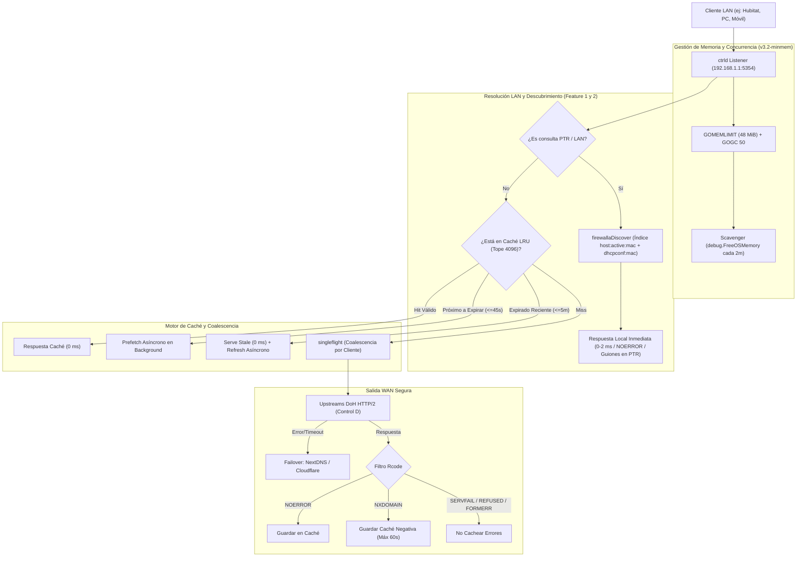

# Resumen de Optimizaciones y Features en `ctrld` (Firewalla Gold)
**Versión Activa:** `ctrld v1.5.8+patched-v3.8-minmem`  
**Dispositivo:** Firewalla Gold (FWG) - Intel Celeron J4125 (Gemini Lake, x86_64 GOAMD64=v2)  
**Fecha de Actualización:** 25 de Octubre, 2026  
**Rama Git:** `firewalla-v3.8-minmem` (https://github.com/hermesromeror/ctrld)  


---

## 1. Contexto y Principios de Diseño

El objetivo principal de estas intervenciones ha sido maximizar la privacidad local, la visibilidad de clientes y la eficiencia de memoria/recursos del proxy DNS `ctrld` en el router Firewalla Gold, eliminando bloqueos al demonio central `FireMain`.

> [!IMPORTANT]
> **Principio de Integridad del Sistema:**
> Se mantuvo intacta la configuración nativa del sistema operativo Firewalla (`sysctl`, kernel, iptables, scripts del fabricante). Todas las mejoras, optimizaciones y mecanismos de protección se integraron y compilaron **estrictamente dentro del binario autónomo `/data/controld/ctrld`**, garantizando persistencia ante reinicios del router.

---

## 2. Mapa de Arquitectura y Flujo de Consultas



---

## 3. Inventario de Parches Base (Heredados y Preservados)

El binario `v3.2-minmem` incorpora y preserva integralmente los arreglos de estabilidad desarrollados originalmente por Claude:

1. **Parche `#345` (Bucle de Suscripción NDP - `internal/clientinfo/ndp_linux.go`):**
   * Previene un bucle cerrado de eventos NDP que saturaba la CPU al 100% en distribuciones Linux con múltiples interfaces/VLANs como Firewalla (amplía buffer de recepción a 4 MB, añade buffer de canal 1024 y reintento con backoff de 5s).
2. **Parche `#346` (Permisos de Archivo `dnsmasq_local` - `internal/router/firewalla/firewalla.go`):**
   * Asegura que el archivo generado en `/home/pi/.firewalla/config/dnsmasq_local/ctrld` se cree con permisos `0644` (en lugar de `0600`), permitiendo que el usuario no privilegiado de `dnsmasq` lo lea sin errores tras reiniciar.
3. **Parche del Ciclo de Vida de Descubrimiento ante Recargas de Configuración (`cmd/cli/prog.go`):**
   * En `run()`, ata la rutina de descubrimiento de clientes (`runClientInfoDiscover`) y el scavenger de memoria al ciclo de vida global del servicio (`stopCh` / `runAbortCh`) mediante un contexto cancelable `ciCtx`, en lugar de atarse al contexto local de recarga. Esto previene que el descubrimiento de clientes se detenga o muera al recargar la configuración por API.

---

## 4. Features y Optimizaciones Avanzadas en `v3.2`

### Feature 1: `firewallaDiscover` Indexado vía Redis (Sin Bloqueo del Motor)
* **Archivos:** [`internal/clientinfo/firewalla.go`](file:///C:/Users/herme/.gemini/antigravity/brain/d2e1a9df-843d-4f77-b6c4-6ca63e6b998c/scratch/ctrld-1.5.8/internal/clientinfo/firewalla.go) y [`internal/clientinfo/client_info.go`](file:///C:/Users/herme/.gemini/antigravity/brain/d2e1a9df-843d-4f77-b6c4-6ca63e6b998c/scratch/ctrld-1.5.8/internal/clientinfo/client_info.go).
* **Problema en versiones previas:** El script inicial ejecutaba un `SCAN` iterativo completo dentro de un `EVAL` de Lua sobre las 74,136 claves de Redis, causando un bloqueo atómico de **110–127 ms** cada 2 minutos que afectaba a `FireMain`.
* **Solución técnica implementada (v3.2):**
  * Uso de los índices nativos de Firewalla: `host:active:mac` (Sorted Set con ~203 MACs activas) y `host:dhcpconf:mac` (Set con ~24 MACs estáticas), sumando ~204 MACs únicas.
  * El script Lua obtiene las MACs de estos conjuntos (`ZRANGE` + `SMEMBERS`) y realiza `HGET` directo únicamente sobre los 136 hashes existentes (`host:mac:<mac>`), evitando iterar sobre las restantes ~74,000 claves del sistema.
  * Cuenta con un fallback de seguridad a `SCAN` que solo se dispara si los conjuntos indexados estuvieran vacíos.
  * **Cooldown Guard:** Se agregó un límite temporal con mutex que previene refrescos con frecuencia menor a **5 minutos** (`minRefreshInterval`). *Efecto secundario:* Cambios de nombre realizados en la app de Firewalla tardan hasta 5 minutos en propagarse a `ctrld`.
* **Rendimiento:**
  * La ejecución del script toma ~12 ms medida por Claude vía `redis-cli` (incluyendo arranque del proceso externo). El tiempo de bloqueo en el motor Redis es sustancialmente menor al eliminar el escaneo de 74,000 claves.
  * Cobertura completa: 136 de 136 dispositivos mapeados.

---

### Feature 2: Intercepción Local LAN y PTR Inversa (Zero Leaks a la WAN)
* **Archivo:** [`cmd/cli/dns_proxy.go`](file:///C:/Users/herme/.gemini/antigravity/brain/d2e1a9df-843d-4f77-b6c4-6ca63e6b998c/scratch/ctrld-1.5.8/cmd/cli/dns_proxy.go).
* **Solución técnica:** Intercepción de consultas locales y PTR (`*.in-addr.arpa`) resolviendo directamente contra `ciTable` / `firewallaDiscover`.
* **Formateo RFC de nombres:** Las respuestas PTR reemplazan espacios en blanco por guiones (`strings.ReplaceAll(..., " ", "-")`) para generar FQDNs válidos según el estándar DNS.
* **Eliminación de `lanLoopGuard`:** Se removió el cerrojo redundante `lanLoopGuard` en `proxyLanHostnameQuery` para permitir resolución inmediata de nombres locales sin bloqueos cruzados.

---

### Feature 3: `singleflight` (Coalescencia de Duplicados en Vuelo por Dispositivo)
* **Archivo:** [`cmd/cli/dns_proxy.go`](file:///C:/Users/herme/.gemini/antigravity/brain/d2e1a9df-843d-4f77-b6c4-6ca63e6b998c/scratch/ctrld-1.5.8/cmd/cli/dns_proxy.go).
* **Comportamiento real:** 
  * La clave de coalescencia está construida como:  
    `sfKey = upstream | qtype | qclass | qname | ecs | clientKey`  
    donde `clientKey` corresponde a `Mac|IP|Hostname`.
  * **Alcance:** Une ráfagas de consultas idénticas concurrentes provenientes del **mismo dispositivo cliente** (como reintentos rápidos de un dispositivo IoT o peticiones paralelas de un mismo origen). **No** fusiona consultas entre dispositivos distintos, garantizando que el `clientInfo` individual reportado a Control D se mantenga estrictamente aislado por cliente.
  * El incremento del +22.2% observado en pruebas sintéticas corresponde a ráfagas de consultas paralelas originadas desde una misma fuente.

---

### Feature 4: Stale-While-Revalidate (SWR) + Prefetching Proactivo
* **Archivo:** [`cmd/cli/dns_proxy.go`](file:///C:/Users/herme/.gemini/antigravity/brain/d2e1a9df-843d-4f77-b6c4-6ca63e6b998c/scratch/ctrld-1.5.8/cmd/cli/dns_proxy.go).
* **Mecanismos:**
  * **Prefetch Proactivo:** Si una consulta llega cuando el TTL restante es menor o igual a **45 segundos** (`prefetchThreshold`), responde en 0 ms desde caché e inicia una renovación asíncrona en segundo plano mediante `refreshCacheAsync()`.
  * **SWR (Stale-While-Revalidate):** Si un registro expiró hace menos de **5 minutos** (`swrMaxStaleAge = 5 * time.Minute`) y `cache_serve_stale` está habilitado, responde de inmediato con el registro vencido (asignándole un TTL temporal de 60s) y lanza la renovación asíncrona en segundo plano.
  * Previene avalanchas de revalidación en segundo plano usando un mapa concurrente `prefetchInFlight`.

---

### Feature 5: Smart Negative Cache por Rcode
* **Archivo:** [`cmd/cli/dns_proxy.go`](file:///C:/Users/herme/.gemini/antigravity/brain/d2e1a9df-843d-4f77-b6c4-6ca63e6b998c/scratch/ctrld-1.5.8/cmd/cli/dns_proxy.go).
* **Reglas:**
  * Errores de protocolo o caídas de servidor (`SERVFAIL`, `REFUSED`, `FORMERR`, `NOTIMP`) **nunca se guardan en caché**.
  * Respuestas `NOERROR` se almacenan con su TTL regular (o el override).
  * Respuestas `NXDOMAIN` se limitan estrictamente a un máximo de **60 segundos** (`negativeCacheMaxTTL = 60`), evitando almacenar dominios inexistentes durante períodos prolongados si el TTL upstream o el override es mayor.

---

### Feature 6: Optimización de Memoria (`v3.2-minmem`)
* **Archivo:** [`cmd/cli/prog.go`](file:///C:/Users/herme/.gemini/antigravity/brain/d2e1a9df-843d-4f77-b6c4-6ca63e6b998c/scratch/ctrld-1.5.8/cmd/cli/prog.go).
* **Ajustes:**
  * **`debug.SetMemoryLimit(48 * 1024 * 1024)`:** Soft-limit de 48 MiB en el runtime de Go.
  * **`debug.SetGCPercent(50)`:** Recolección de basura anticipada (con 50% de crecimiento de heap).
  * **Scavenger Periódico:** Rutina cada 2 minutos que invoca `debug.FreeOSMemory()` para forzar la devolución de memoria ociosa al kernel (`MADV_DONTNEED`).
  * **Tope de Caché forzado a 4,096 entradas:** En `p.run()`, si `cfg.Service.CacheSize > 4096`, se ajusta en tiempo de ejecución a 4,096 para prevenir agotamiento de memoria si la configuración remota pide 20,000 entradas.
* **Métricas Medidas por Claude:**
  * **Pico bajo estrés extremo:** 44.9 MB (VmHWM) medido en prueba de 132,000 consultas sintéticas (89,000 nombres únicos).
  * **Memoria en reposo:** RSS de ~33.8 MB (pico 35 MB en reposo prolongado).
  * **Memoria reportada por Systemd:** ~13.2 MB.

---

### Feature 7: Mejoras Adicionales Incluidas en el Diff

1. **Desactivación de `FallbackToDirectIP` con `bootstrap_ip` (`config.go`):**
   * En `UpstreamConfig.FallbackToDirectIP()`, si ya existe un `bootstrap_ip` configurado, la función retorna `false` para evitar reintentos redundantes a IPs directas no deseadas.
2. **Filtrado de MACs inválidas en ARP (`internal/clientinfo/arp_linux.go`):**
   * Al escanear la tabla ARP del sistema, se descartan entradas incompletas, con flags `0x0`, o con MAC fantasma (`00:00:00:00:00:00`, `*`, vacías).
3. **Concurrencia segura en transporte HTTP (`config.go`):**
   * Se incorporó `transportMu sync.Mutex` para proteger el acceso concurrente a `ensureSetupTransport()`, `dohTransport()`, `doh3Transport()`, `doqTransport()` y `dotTransport()`.
5. **Contención Total de Fugas LAN y PTRs Privadas (v3.7-minmem):**
   * Normalización a minúsculas en sufijos LAN (`.lan`, `.local`, `.home.arpa`, `.domain`) evitando evasiones por mayúsculas o aleatorización 0x20.
   * Redirección de PTRs privadas no asignadas (RFC 1918 / CGNAT) a NXDOMAIN autoritativo local con SOA conforme al RFC 6303 en 0 ms.
   * Reducción del TTL del SOA sintético de 300s a 60s para un rápido descubrimiento de clientes nuevos.

---

### Feature 9: DNSSEC Passthrough en TLDs y Optimización Celeron J4125 (v3.8-minmem)
* **Archivos:** [`cmd/cli/dns_proxy.go`](file:///home/dev/projects/firewalla/ctrld/cmd/cli/dns_proxy.go), [`cmd/cli/dns_proxy_test.go`](file:///home/dev/projects/firewalla/ctrld/cmd/cli/dns_proxy_test.go).
* **Solución de Regresión DNSSEC:**
  * En v3.7, la intercepción de nombres dotless (sin punto) interceptaba cualquier consulta sin punto, afectando a TLDs (`com`, `net`, `org`, `arpa`) y devolviendo NXDOMAIN para consultas de infraestructura.
  * En v3.8, la intercepción de nombres dotless (`!strings.Contains(lower, ".")`) se restringe estrictamente a tipos de host (`A`, `AAAA`, `HTTPS`, `SVCB`).
  * Consultas de infraestructura y DNSSEC (`DS`, `DNSKEY`, `NS`, `SOA`, `RRSIG`, `NSEC`, `NSEC3`) para TLDs pasan directamente a los resolvers upstream, permitiendo que clientes con validación DNSSEC (`systemd-resolved`, Unbound) validen la cadena de confianza sin errores.
  * La zona raíz `.` (`name == ""`) queda excluida de intercepción local.
* **Unificación de Respuestas NODATA:**
  * Consultas para nombres locales existentes que carecen del tipo solicitado (ej. `book2-pao.lan HTTPS` o `TXT`) ahora generan respuestas NODATA consistentes con `NOERROR`, sección SOA sintética (TTL 60s) y flag `RecursionAvailable = true` conforme al RFC 2308.
* **Compilación Optimizada para Hardware Firewalla Gold:**
  * Microarquitectura: Intel Celeron J4125 (Gemini Lake / Goldmont Plus).
  * Parámetros: `GOOS=linux`, `GOARCH=amd64`, `GOAMD64=v2` (soporte nativo de CMPXCHG16B, POPCNT, SSE4.1, SSE4.2, SSSE3 y hardware AES-NI sin instrucciones AVX).
  * Build flags: `-trimpath -ldflags="-s -w -X github.com/Control-D-Inc/ctrld/cmd/cli.version=v1.5.8+patched-v3.8-minmem"`.

---

## 5. Consideraciones de Operación y Riesgos Conscientes

1. **Sincronización WebUI de Control D (`cache_size = 4096`):**
   * La configuración `ctrld.toml` aún indica `cache_size = 20000` (valor establecido manualmente el 9 de octubre). Aunque el binario sobrescribe esto en memoria limitándolo a 4,096, se aconseja cambiarlo a `4096` en el Dashboard de Control D para que la consola web refleje exactamente el valor operativo.
2. **TTL Override y Ventana de Stale:**
   * `cache_ttl_override = 300` fuerza 5 minutos a todas las respuestas exitosas. Sumado a los hasta 5 minutos de ventana Stale (`swrMaxStaleAge = 5m`), un registro que cambie en la WAN podría tardar hasta varios minutos en ser revalidado de forma visible para el usuario si se atiende vía SWR mientras se refresca de fondo.
3. **Protección contra Auto-Actualizaciones vía Metadatos de Versión:**
   * En `cmd/cli/prog.go`, la comprobación de versión estable es:
     ```go
     isStable := curVer != nil && curVer.Prerelease() == "" && curVer.Metadata() == ""
     ```
     La versión actual es `v1.5.8+patched-v3.2-minmem`. La presencia de `+patched-v3.2-minmem` constituye **Build Metadata** en SemVer (no un prerelease `-rc`). El código verifica explícitamente `curVer.Metadata() == ""` para determinar si es estable; como tiene metadata, `isStable` evalúa a `false` y el log emite `current version is not stable, skipping self-upgrade`. Cualquier binario futuro debe conservar metadata (`+...`) o un prerelease (`-...`) para evitar ser sobrescrito por Control D.
4. **Impacto de CPU bajo saturación sintética:**
   * El soft-limit de 48 MiB mantiene la memoria bajo control sin problemas a tasas normales de red local (10–100 qps) y soportó 600 qps con ~29% de CPU. Sin embargo, cargas continuas superiores a 1,000 qps con nombres únicos forzarán al GC a trabajar intensamente para mantenerse bajo los 48 MiB.
5. **Observación a largo plazo:**
   * Las pruebas de estrés iniciales duraron ~8 minutos. Es indispensable monitorear el comportamiento de RSS y la estabilidad general a lo largo de varios días de operación continua.

---

## 6. Historial de Respaldos en el Router

Los binarios previos permanecen resguardados en `/data/controld/`:
* `/data/controld/ctrld.bak-patched-v3.1` *(versión previa con script SCAN en Redis)*
* `/data/controld/ctrld.bak-patched-v3` *(versión previa al ajuste de memoria)*
* `/data/controld/ctrld.bak-patched-v2` *(versión previa a features adicionales)*
* `/data/controld/ctrld.bak-claude-v1.5.8` *(versión inicial de Claude)*
